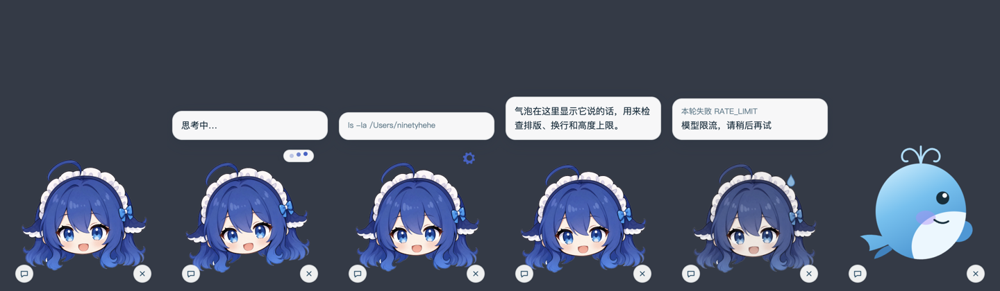

# DSH Desk Pet

**Put DeepSeek Harness on your desktop, and watch it think, work, and talk.**

A desk pet plugin for DeepSeek Harness · transparent always-on-top window · 5 event-driven states · 2 skins · starts and stops with DSH

Built for **@deepseek-ai/dsh 0.2.1-rc.2** · Electron 45 · [中文](../README.md) · [日本語](README.ja.md) · [한국어](README.ko.md)



---

## What it is

DSH Desk Pet is a DSH plugin that runs on your own machine. When DSH starts, it opens a small window in the bottom-right corner of the screen and turns what is happening in the session into the character's motion:

- **See the progress**: thinking, calling a tool, and replying each have their own motion; tool calls show the command or file path in the bubble.
- **Ask on the spot**: click the bottom-left button, type, press Enter. No need to switch back to the browser.
- **One conversation**: the pet always uses the `desk-pet` session. The Web UI shows the same history, and it is restored after a restart.
- **Errors are not silent**: model failures, rejected tools, and blocked turns make the character shake and show the reason.

The pet has no kernel of its own. Model settings, session storage, and permission policy all come from the DSH process that launched it. When DSH exits, the pet exits too.

## Design principles

| Principle | Meaning |
| --- | --- |
| Bound to DSH | Only launched by the DSH plugin; no separate kernel, no session store of its own. Running Electron directly exits with an error |
| Every state has a source | Each motion maps to a DSH session event; nothing is random or guessed from timers |
| Errors are explicit | Missing Electron, failed session resume, invalid skin config all raise an error instead of silently falling back |
| Renderer has no power | The page only gets 4 IPC methods, with `contextIsolation` and CSP on; no Node, no network |

## Install

In the project directory:

```sh
npm install                       # installs the bundled DSH and Electron; no global dsh needed
npm start                         # same as: dsh web --patch cordis.patch.yml
```

Open `http://127.0.0.1:3080/` in the browser; the pet appears in the bottom-right corner at the same time. Extra flags pass through, e.g. `npm start -- --no-open`.

### Add it to your usual profile

To have your everyday `dsh web` start the pet too, append the `insert` block from `cordis.patch.yml` to `$DSH_HOME/profiles/web/cordis.patch.yml`, and change the plugin path to an absolute path on your machine.

### What install does not touch

- `npm start` only overlays the plugin through `--patch`; it **does not modify** any profile file under `$DSH_HOME`.
- The plugin only subscribes to events of the `desk-pet` session; it **does not read** your other sessions.
- The pet process is managed by DSH's `ctx.subprocess`. It is terminated and reaped when DSH exits or the plugin unloads, leaving no background process.
- If your shell sets `NODE_ENV=production`, npm skips devDependencies. Electron is therefore listed in `dependencies` and works right after install.

## Controls

| Action | Effect |
| --- | --- |
| Drag the character | Move the window |
| Bottom-left button | Open / close the input box; Enter to send, `Esc` to close |
| Right-click | Menu: always-on-top toggle, open the DSH data directory, quit |
| Bottom-right button | Close the pet (DSH keeps running) |
| Type `/pet` in the Web UI | Reopen a closed pet; if it is already open, bring it to the front |

## Where states come from

| Character | Motion (avatar skin) | DSH event |
| --- | --- | --- |
| Idle | Gentle head sway | No event |
| Thinking | Head tilt, bouncing dots above | `turn/start`, `step/start`, `agent/status=running` |
| Working | Quick nodding, spinning gear, command in the bubble | `tool/call` |
| Talking | Bouncing, reply typed out in the bubble | `assistant/message` |
| Error | Shaking, greyed out, sweat drop, reason in the bubble | `message.isError` on `tool/result`; `reason.kind` of `error` / `blocked` on `turn/end` |

## Configuration

Add `config` under the plugin entry in `cordis.patch.yml`:

```yaml
- insert:
    - id: desk-pet
      name: /path/to/dsh-native-bot/plugin/desk-pet.mjs
      config:
        skin: whale
```

| Key | Default | Purpose |
| --- | --- | --- |
| `skin` | `avatar` | `avatar` (bitmap portrait, moves as a whole) or `whale` (hand-drawn SVG, moves part by part); an invalid value raises an error |
| `sessionId` | `desk-pet` | Session id used by the pet |
| `title` | `桌宠` | Session title in the Web UI sidebar; a title you set by hand in the Web UI wins |
| `cwd` | DSH's working directory | Working directory for a newly created session |
| `projectDir` | The repo containing the plugin | Directory of the pet front end |
| `electron` | Electron from project dependencies | Path to the Electron executable |

Once the pet connects, it opens its session and attaches it to the workspace matching the session's working directory, registering one if needed. You can find it in the Web UI sidebar and continue the chat there.

## Changing the look

- **`avatar`**: `src/renderer/avatar.png`, transparent background, cropped to content, about 640px wide. Replace this one file; no motion changes needed.
- **`whale`**: the `<svg>` in `src/renderer/index.html`, gradient fills plus CSS keyframes, no image assets.
- A bitmap can only move as a whole. Blinking and mouth movement need closed-eye and closed-mouth variants of the same character.
- Using someone else's artwork is fine for personal use; confirm you have the rights before publishing.

## Compatibility

| Component | Value |
| --- | --- |
| DSH | `@deepseek-ai/dsh` 0.2.1-rc.2, installed as a project dependency |
| Electron | 45.x, UI only; does not run the DSH kernel |
| Node | ≥20.11, to run DSH |
| OS | Verified on macOS; Windows / Linux not verified |

## Troubleshooting

```sh
npm test                                      # syntax check + unit tests, DSH need not be running
npm run test:e2e                              # real Electron integration test: close -> /pet -> reappears; the pet briefly shows on screen
DSH_PET_SELFTEST=1 npm start -- --no-open     # end-to-end self test: uses a separate session desk-pet-selftest, sends one message, saves /tmp/pet-selftest.png, exits
DSH_PET_SHOT=/tmp/pet.png DSH_PET_SHOT_STATE=talking ./node_modules/.bin/electron .
                                              # render only, no DSH; states: thinking / working / talking / error
```

Diagnostics from the plugin and the pet start with `[desk-pet]` and are printed in the terminal that started DSH. If 3080 does not open, first make sure `dsh web` is actually running; `--patch` must come right after `web`.

## Known limitations

- The typewriter effect is simulated locally; the plugin does not consume the token-level `agent/assistant-stream` yet.
- Tool calls that need approval do not prompt in the pet; they follow the DSH policy and can be approved in the Web UI.
- The window stays on the primary display and does not follow across monitors.
- Animation is CSS keyframes only; no rigging or frame sequences.

## Layout

```
plugin/desk-pet.mjs     DSH-side plugin: launches the pet, forwards events, delivers prompts, reaps the process
cordis.patch.yml        Overlay that mounts the plugin into a profile
src/main.mjs            Electron main process: window, menu, IPC, launch guard
src/stdio-kernel.mjs    Channel to the plugin: one JSON per line over stdin/stdout; stdout is protocol-only
src/state.mjs           Session events -> character state (pure functions)
src/preload.cjs         The only capability exposed to the renderer
src/renderer/           Look, animation, bubble
```

```sh
npm run check           # syntax check for all sources
```

Keywords: DeepSeek Harness · DSH plugin · desktop pet · desk pet · Electron · transparent window · session events · state machine
